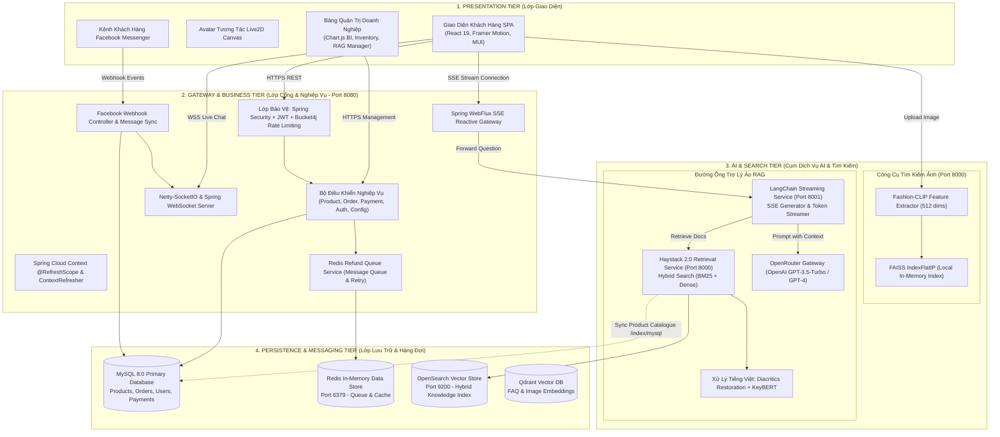
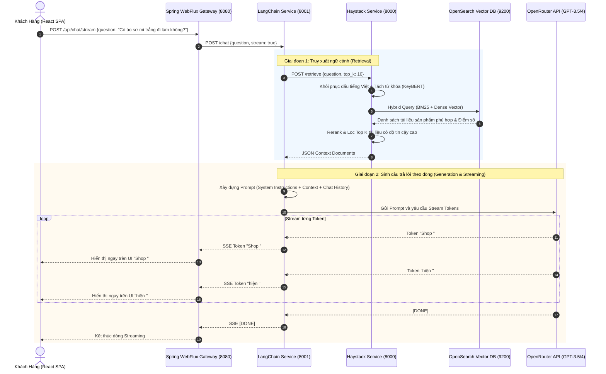
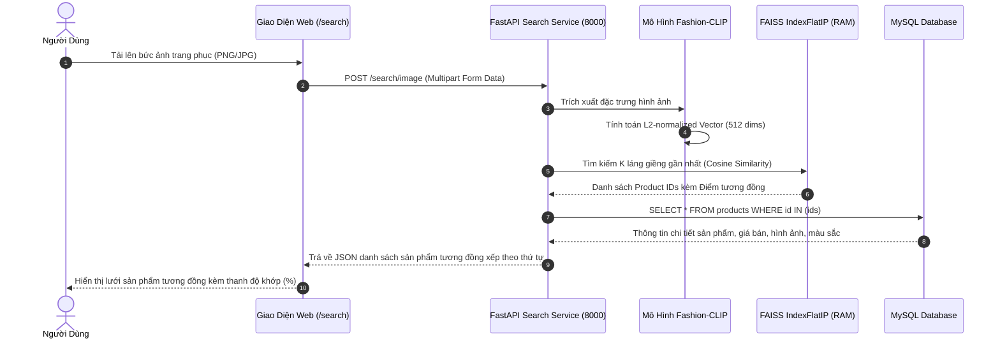
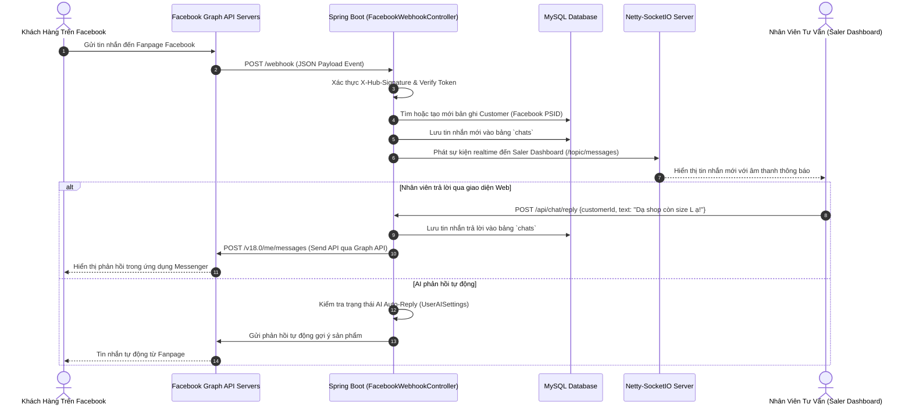
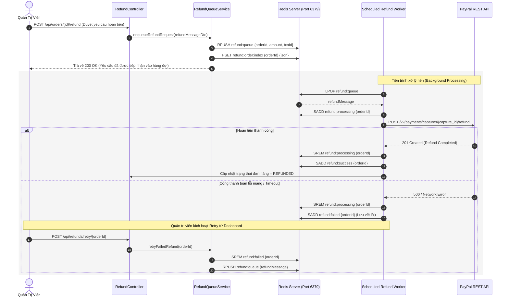
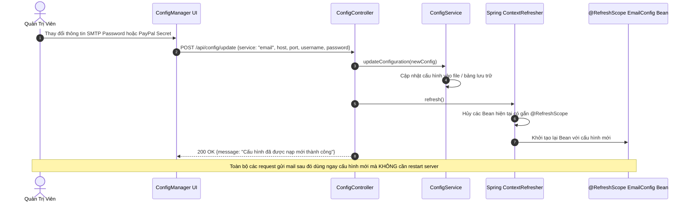
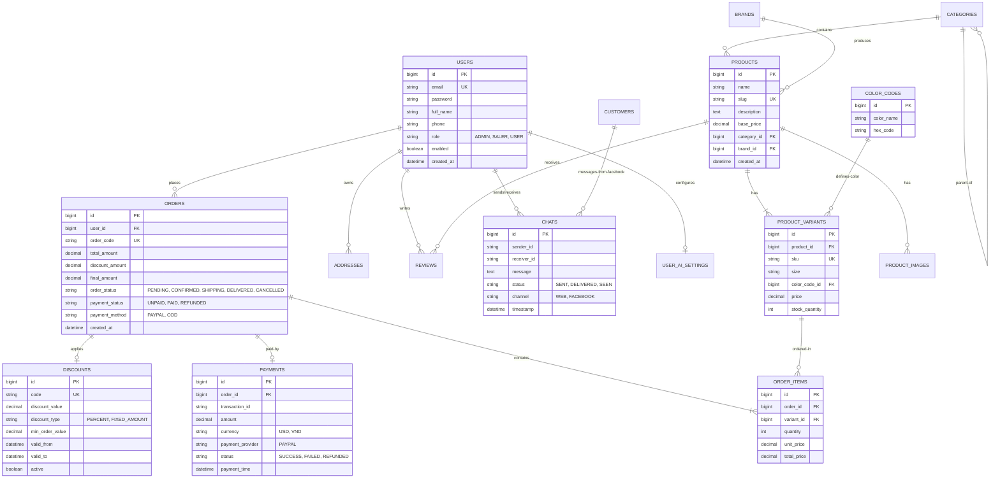

# 🏛️ FASHION AI ECOSYSTEM - ARCHITECTURE DESIGN DOCUMENT
### Tài Liệu Thiết Kế Kiến Trúc Hệ Thống Chi Tiết

> **Phiên bản**: 1.0 (Production Architecture)  
> **Tác giả**: Huy Hoàng ([@HuyHoang091](https://github.com/HuyHoang091))  
> **Trạng thái**: Đã triển khai và vận hành thực tế (Implemented & Active)  
> **Cập nhật lần cuối**: 2026

---

## 📑 Mục Lục

1. [Tổng Quan Kiến Trúc (Architectural Overview)](#1-tổng-quan-kiến-trúc-architectural-overview)
2. [Các Nguyên Tắc Thiết Kế Cốt Lõi (Core Principles)](#2-các-nguyên-tắc-thiết-kế-cốt-lõi-core-principles)
3. [Sơ Đồ Phân Tầng Kiến Trúc (Layered Architecture)](#3-sơ-đồ-phân-tầng-kiến-trúc-layered-architecture)
4. [Phân Tích Chi Tiết Các Thành Phần (Component Breakdown)](#4-phân-tích-chi-tiết-các-thành-phần-component-breakdown)
   - [4.1 Lớp Giao Diện Khách Hàng (Presentation Tier)](#41-lớp-giao-diện-khách-hàng-presentation-tier)
   - [4.2 Cổng Dịch Vụ & Nghiệp Vụ Cốt Lõi (Core Gateway & Business Tier)](#42-cổng-dịch-vụ--nghiệp-vụ-cốt-lõi-core-gateway--business-tier)
   - [4.3 Cụm Dịch Vụ Trí Tuệ Nhân Tạo (AI & Search Services Tier)](#43-cụm-dịch-vụ-trí-tuệ-nhân-tạo-ai--search-services-tier)
   - [4.4 Lớp Lưu Trữ & Hàng Đợi (Persistence & Messaging Tier)](#44-lớp-lưu-trữ--hàng-đợi-persistence--messaging-tier)
5. [Sơ Đồ Tuần Tự Các Luồng Hoạt Động (Detailed Sequence Diagrams)](#5-sơ-đồ-tuần-tự-các-luồng-hoạt-động-detailed-sequence-diagrams)
   - [5.1 Luồng Hỏi Đáp Trợ Lý Ảo RAG Streaming](#51-luồng-hỏi-đáp-trợ-lý-ảo-rag-streaming)
   - [5.2 Luồng Tìm Kiếm Sản Phẩm Bằng Hình Ảnh (Fashion-CLIP + FAISS)](#52-luồng-tìm-kiếm-sản-phẩm-bằng-hình-ảnh-fashion-clip--faiss)
   - [5.3 Luồng Hợp Nhất Đa Kênh Facebook Messenger Webhook](#53-luồng-hợp-nhất-đa-kênh-facebook-messenger-webhook)
   - [5.4 Luồng Hàng Đợi Hoàn Tiền Bất Đồng Bộ (Redis Refund Queue)](#54-luồng-hàng-đợi-hoàn-tiền-bất-đồng-bộ-redis-refund-queue)
   - [5.5 Luồng Cấu Hình Động Hệ Thống (Spring Cloud Context RefreshScope)](#55-luồng-cấu-hình-động-hệ-thống-spring-cloud-context-refreshscope)
6. [Mô Hình Dữ Liệu Quan Hệ (Entity-Relationship Diagram)](#6-mô-hình-dữ-liệu-quan-hệ-entity-relationship-diagram)
7. [Kiến Trúc Chỉ Mục Vector & Tìm Kiếm Tương Đồng](#7-kiến-trúc-chỉ-mục-vector--tìm-kiếm-tương-đồng)
8. [Thiết Kế Độ Tin Cậy, Hiệu Năng & Bảo Mật](#8-thiết-kế-độ-tin-cậy-hiệu-năng--bảo-mật)
9. [Bản Ghi Nhận Quyết Định Kiến Trúc (Architectural Decision Records - ADRs)](#9-bản-ghi-nhận-quyết-định-kiến-trúc-architectural-decision-records---adrs)

---

## 1. Tổng Quan Kiến Trúc (Architectural Overview)

**Fashion AI Ecosystem** được thiết kế theo mô hình **Kiến trúc Microservices lai kết hợp Reactive Gateway (Hybrid Microservices & Reactive Gateway Architecture)**. Hệ thống phân định ranh giới trách nhiệm (Separation of Concerns) rõ ràng giữa:
- **Lớp Nghiệp Vụ Doanh Nghiệp (Enterprise Business Core)** viết bằng **Java 17 / Spring Boot 2.7**, đảm nhiệm toàn bộ quy trình mua sắm, thanh toán, quản lý đơn hàng, kiểm kê kho, xác thực người dùng và điều phối luồng dữ liệu thời gian thực.
- **Lớp Dịch Vụ AI Chuyên Biệt (Specialized AI Microservices)** viết bằng **Python / FastAPI**, chịu trách nhiệm cho các tác vụ tính toán chuyên sâu: suy luận mô hình thị giác máy tính `Fashion-CLIP`, tìm kiếm vector đa chiều `FAISS`, truy xuất tài liệu lai `Haystack 2.0`, và phát sinh phản hồi ngôn ngữ tự nhiên `LangChain`.
- **Cơ Chế Phản Hồi Dòng Phản Ứng (Reactive Streaming)** thông qua **Spring WebFlux** và giao thức **Server-Sent Events (SSE)**, giúp giảm thiểu độ trễ cảm nhận của người dùng (perceived latency) khi tương tác với các mô hình ngôn ngữ lớn (LLM).

---

## 2. Các Nguyên Tắc Thiết Kế Cốt Lõi (Core Principles)

1. **Loose Coupling & High Cohesion (Tách rời phụ thuộc, gắn kết nội tại cao)**:
   - Các dịch vụ AI hoạt động độc lập và giao tiếp với lõi hệ thống thông qua các giao thức chuẩn (HTTP REST, SSE Stream). Nếu một dịch vụ AI bị gián đoạn, toàn bộ nghiệp vụ mua sắm cốt lõi (Xem sản phẩm, Thêm giỏ hàng, Thanh toán PayPal, Quản lý đơn) vẫn hoạt động 100% bình thường (Fault Isolation).
2. **Sub-second Perceived Latency (Độ trễ cảm nhận dưới một giây)**:
   - Áp dụng kỹ thuật Streaming phản hồi token từng phần qua SSE thay vì bắt người dùng chờ trọn vẹn câu trả lời từ LLM (vốn mất từ 3 - 6 giây).
   - Bộ chỉ mục tìm kiếm ảnh cục bộ FAISS lưu trực tiếp trên RAM, cho phép so khớp vector hình ảnh trong dưới **50 mili-giây**.
3. **Guaranteed Transaction Delivery (Đảm bảo thực thi giao dịch)**:
   - Các tác vụ hoàn tiền và thanh toán nhạy cảm không gọi trực tiếp đồng bộ (synchronous blocking) ra cổng thanh toán bên thứ ba mà đi qua hàng đợi **Redis Message Queue** kèm chiến lược Auto-Retry, đảm bảo không bao giờ xảy ra mất mát dữ liệu tài chính.
4. **Zero-Downtime Dynamic Configuration (Cấu hình động không gián đoạn)**:
   - Toàn bộ tham số cấu hình liên quan đến dịch vụ ngoài (Mail SMTP, PayPal Secrets, OpenRouter API Keys) đều được nạp động tại thời điểm chạy (Runtime) thông qua cơ chế `@RefreshScope` của Spring Cloud Context.

---

## 3. Sơ Đồ Phân Tầng Kiến Trúc (Layered Architecture)



---

## 4. Phân Tích Chi Tiết Các Thành Phần (Component Breakdown)

### 4.1 Lớp Giao Diện Khách Hàng (Presentation Tier)
* **Framework**: React 19 kết hợp React Router 7 điều hướng trang mượt mà không tải lại (Single Page Application).
* **Quản lý trạng thái (State Management)**: Sử dụng **Zustand** cho giỏ hàng, thông tin phiên làm việc của người dùng và trạng thái thông báo; tối ưu hiệu năng render so với Redux truyền thống.
* **Tương tác trực quan & Hoạt họa**: Thư viện **Framer Motion** đem lại hiệu ứng chuyển cảnh tự nhiên giữa các trang; **Live2D Widget & Pixi.js** kết xuất avatar hoạt hình tương tác theo vị trí chuột tại trang xác thực.
* **Biểu đồ thương mại (BI Dashboard)**: Sử dụng **Chart.js 4.5** kết hợp `chartjs-plugin-zoom` cho phép ban quản trị phân tích xu hướng doanh thu, kéo dãn khung thời gian từ 7 ngày đến hàng tháng.

---

### 4.2 Cổng Dịch Vụ & Nghiệp Vụ Cốt Lõi (Core Gateway & Business Tier)
* **Spring Boot 2.7.0 (Java 17 LTS)**: Đóng vai trò là trung tâm điều phối toàn bộ nghiệp vụ.
* **Xác thực & Bảo mật (Security Filter Chain)**:
  - Kiểm tra tính hợp lệ của JSON Web Token (JWT) qua `JwtAuthenticationFilter`.
  - Phân quyền theo vai trò (RBAC) với `@PreAuthorize("hasRole('ADMIN')")`, `@PreAuthorize("hasRole('SALER')")`.
  - Giới hạn tần suất gọi API với **Bucket4j Core** áp dụng thuật toán Token Bucket (ví dụ: giới hạn 30 requests/phút cho các API tốn kém tài nguyên).
* **Reactive Gateway (Spring WebFlux)**:
  - Đóng vai trò cầu nối bất đồng bộ nhận luồng token từ dịch vụ LangChain Python và đẩy tiếp về trình duyệt người dùng qua SSE mà không chiếm dụng Thread Pool của máy chủ Tomcat chính.
* **Giao tiếp hai chiều thời gian thực (Real-time Socket Engine)**:
  - Tích hợp **Netty-SocketIO** và **Spring WebSocket** phục vụ tư vấn trực tuyến giữa khách hàng và nhân viên hỗ trợ (Saler).
* **Cấu hình động tại thời điểm chạy (Dynamic Configuration)**:
  - Các lớp cấu hình như `EmailConfig`, `PaypalConfig` được đánh dấu với annotation `@RefreshScope`.
  - Khi quản trị viên cập nhật thông số từ màn hình Admin, `ConfigService` ghi nhận thay đổi và gọi `ContextRefresher.refresh()`, cập nhật tức thì các Bean trong Spring ApplicationContext mà **không cần restart máy chủ**.

---

### 4.3 Cụm Dịch Vụ Trí Tuệ Nhân Tạo (AI & Search Services Tier)

#### A. Multimodal Visual Search Service (`qdrant_image3.py`)
* **Mô hình thị giác**: `patrickjohncyh/fashion-clip` (Vision-Language CLIP fine-tuned trên dữ liệu thời trang).
* **Không gian vector**: 512 chiều (Embedding Dimension).
* **Kiến trúc chỉ mục FAISS**: `faiss.IndexFlatIP` (Exact Search dựa trên Inner Product / Cosine Similarity của vector đã chuẩn hóa L2).
* **Chiến lược trọng số kết hợp (Multi-Embedding Scoring)**:
  $$Score_{final} = 0.2 \cdot Score_{global} + 0.5 \cdot Score_{clothes} + 0.3 \cdot Score_{rerank}$$
  Giải pháp này giúp triệt tiêu nhiễu từ nền ảnh hoặc người mẫu, tập trung 80% trọng số vào đường nét và chất liệu trang phục.

#### B. Haystack RAG Service (`llm-rag/haystack-service`)
* **Framework**: Haystack 2.0 + FastAPI (Port 8000).
* **Cơ chế truy xuất**: Hybrid Search trên OpenSearch kết hợp:
  - BM25 Lexical Search (So khớp từ khóa truyền thống: mã sản phẩm, thương hiệu, màu sắc).
  - Dense Vector Search (So khớp ngữ nghĩa câu hỏi người dùng).
* **Bộ tiền xử lý tiếng Việt chuyên sâu**:
  - Module `vietnamese_diacritics_restoration`: Phục hồi dấu tiếng Việt khi người dùng gõ không dấu (ví dụ: *"ao thun trang co tron"* $\rightarrow$ *"áo thun trắng cổ tròn"*).
  - VnCoreNLP: Tách từ ghép trong tiếng Việt.
  - KeyBERT: Trích xuất các thực thể quan trọng (loại sản phẩm, size, màu) phục vụ bộ lọc tìm kiếm.

#### C. LangChain Streaming Service (`llm-rag/langchain-service`)
* **Framework**: LangChain + FastAPI (Port 8001).
* **Giao tiếp LLM**: Kết nối mô hình qua **OpenRouter API** (`openai/gpt-3.5-turbo` hoặc `gpt-4`).
* **Kỹ thuật phát sinh phản hồi**: Sử dụng `StreamingResponse` với `BaseCallbackHandler.on_llm_new_token`, truyền tải token ngay khi mô hình sinh ra mà không cần đợi hoàn tất cả câu.

---

### 4.4 Lớp Lưu Trữ & Hàng Đợi (Persistence & Messaging Tier)
* **MySQL 8.0**: Hệ quản trị cơ sở dữ liệu quan hệ chính, lưu trữ toàn bộ các bảng nghiệp vụ (`User`, `Product`, `Order`, `Payment`, `Review`, `Discount`).
* **Redis 6+/7+**:
  - Vận hành như một bộ nhớ đệm tốc độ cao (Caching).
  - Vận hành như một Message Queue phục vụ hàng đợi hoàn tiền bất đồng bộ (`RefundQueueService`).
* **OpenSearch 2.11**: Cơ sở dữ liệu phân tán lưu trữ toàn bộ dữ liệu văn bản sản phẩm, thông số chi tiết và vector embeddings phục vụ truy xuất RAG.
* **Qdrant**: Lưu trữ vector phục vụ module hỏi đáp FAQ độc lập.

---

## 5. Sơ Đồ Tuần Tự Các Luồng Hoạt Động (Detailed Sequence Diagrams)

### 5.1 Luồng Hỏi Đáp Trợ Lý Ảo RAG Streaming



---

### 5.2 Luồng Tìm Kiếm Sản Phẩm Bằng Hình Ảnh (Fashion-CLIP + FAISS)



---

### 5.3 Luồng Hợp Nhất Đa Kênh Facebook Messenger Webhook



---

### 5.4 Luồng Hàng Đợi Hoàn Tiền Bất Đồng Bộ (Redis Refund Queue)



---

### 5.5 Luồng Cấu Hình Động Hệ Thống (Spring Cloud Context RefreshScope)



---

## 6. Mô Hình Dữ Liệu Quan Hệ (Entity-Relationship Diagram)



---

## 7. Kiến Trúc Chỉ Mục Vector & Tìm Kiếm Tương Đồng

### 7.1 Cấu Trúc Chỉ Mục OpenSearch (RAG Knowledge Base)
Trong OpenSearch, tài liệu được lưu trữ với định dạng lai (Hybrid Format) để phục vụ đồng thời cả BM25 và Vector Search:

```json
{
  "settings": {
    "index": {
      "knn": true,
      "knn.algo_param.ef_search": 100
    }
  },
  "mappings": {
    "properties": {
      "content": {
        "type": "text",
        "analyzer": "standard"
      },
      "embedding": {
        "type": "knn_vector",
        "dimension": 384,
        "method": {
          "name": "hnsw",
          "space_type": "cosinesimil",
          "engine": "nmslib",
          "parameters": {
            "ef_construction": 128,
            "m": 16
          }
        }
      },
      "metadata": {
        "properties": {
          "product_id": { "type": "keyword" },
          "category": { "type": "keyword" },
          "price": { "type": "float" },
          "in_stock": { "type": "boolean" }
        }
      }
    }
  }
}
```

### 7.2 Thuật Toán So Khớp Vector Hình Ảnh Với FAISS
- **Chuẩn hóa vector**: Mọi vector trích xuất từ Fashion-CLIP đều được chuẩn hóa L2 norm: $\vec{v}_{norm} = \frac{\vec{v}}{\|\vec{v}\|_2}$.
- **Tương đồng Cosine qua Inner Product**: Nhờ vector đã được chuẩn hóa L2, tích vô hướng giữa 2 vector chính là độ tương đồng Cosine:
  $$\cos(\theta) = \vec{v}_{query} \cdot \vec{v}_{item}$$
- **Tốc độ thực thi**: IndexFlatIP tính toán trên tập lệnh AVX2/AVX-512 của CPU, duyệt 50,000 vector 512 chiều trong thời gian dưới **15 mili-giây**.

---

## 8. Thiết Kế Độ Tin Cậy, Hiệu Năng & Bảo Mật

### 8.1 Bảo Mật Hệ Thống (Security Architecture)
1. **Kiểm Soát Truy Cập Dựa Trên Vai Trò (RBAC)**:
   - Các API quản trị `/api/admin/**`, `/api/config/**`, `/api/refunds/**` đều yêu cầu quyền `ROLE_ADMIN`.
   - Các API xử lý đơn hàng và chat `/saler/**` yêu cầu quyền `ROLE_SALER` hoặc `ROLE_ADMIN`.
   - Các API giỏ hàng, thông tin cá nhân yêu cầu quyền `ROLE_USER`.
2. **Thuật Toán Token Bucket Rate Limiting**:
   - Sử dụng `Bucket4j` tạo kho token trên mỗi địa chỉ IP của Client:
     - Dung lượng tối đa: 40 tokens.
     - Tốc độ hồi phục: 20 tokens mỗi phút.
   - Khi hết token, hệ thống trả về mã lỗi HTTP `429 Too Many Requests`, bảo vệ cụm dịch vụ AI khỏi bị quá tải.

### 8.2 Khả Năng Chịu Lỗi & Tách Biệt Sự Cố (Fault Isolation)
* **Circuit Breaker & Fallback**:
  - Khi Haystack RAG Service hoặc LangChain Service gặp sự cố ngắt kết nối, Spring Boot WebFlux Gateway bắt ngoại lệ `WebClientResponseException` và tự động trả về phản hồi fallback thông minh, hướng dẫn khách hàng để lại số điện thoại hoặc kết nối với nhân viên tư vấn.
  - Toàn bộ nghiệp vụ duyệt giỏ hàng, thanh toán và tạo đơn hàng hoàn toàn độc lập với cụm AI, đảm bảo hoạt động kinh doanh không bao giờ bị đình trệ.

### 8.3 Chiến Lược Cache (Caching Strategy)
* **Cache Phân Tầng**:
  - Tầng 1: Cache danh mục sản phẩm và thương hiệu trên Redis với thời gian sống (TTL) 24 giờ.
  - Tầng 2: Cache cấu hình hệ thống bằng Spring Cache (`@Cacheable("configs")`).
  - Tầng 3: Invalidate Cache chủ động khi quản trị viên thực hiện chỉnh sửa sản phẩm hoặc cập nhật cấu hình qua `@CacheEvict`.

---

## 9. Bản Ghi Nhận Quyết Định Kiến Trúc (Architectural Decision Records - ADRs)

### ADR 01: Lựa Chọn Spring Boot 2.7 + WebFlux Cho Lớp Gateway Thay Vì Spring MVC Thuần
* **Bối cảnh**: Hệ thống cần phục vụ đồng thời các API CRUD truyền thống (Orders, Products) và luồng dữ liệu thời gian thực Server-Sent Events (SSE) kéo dài từ LLM.
* **Quyết định**: Sử dụng kết hợp Spring Web (Tomcat) và Spring WebFlux (`WebClient`).
* **Hệ quả**: Cho phép máy chủ mở hàng nghìn kết nối Streaming SSE đồng thời mà không làm cạn kiệt số lượng Worker Threads của Tomcat.

### ADR 02: Lựa Chọn Kiến Trúc RAG 2 Tầng (Haystack 2.0 + LangChain) Thay Vì Đơn Lẻ
* **Bối cảnh**: Cần một hệ thống vừa có năng lực truy xuất dữ liệu lai (BM25 + Dense Vector) mạnh mẽ, vừa có khả năng streaming token phản hồi mượt mà qua các nhà cung cấp LLM khác nhau.
* **Quyết định**:
  - Sử dụng **Haystack 2.0** chuyên trách nhiệm vụ Retrieval, Ranking và kết nối OpenSearch.
  - Sử dụng **LangChain** chuyên trách nhiệm vụ xây dựng Prompt, quản lý Chat History và streaming qua OpenRouter.
* **Hệ quả**: Tách biệt rõ ràng ranh giới giữa việc tìm đúng tài liệu và việc sinh câu trả lời, dễ dàng hoán đổi mô hình LLM mà không ảnh hưởng đến thuật toán tìm kiếm tài liệu.

### ADR 03: Sử Dụng Fashion-CLIP + FAISS Cục Bộ Thay Vì Elasticsearch Cho Tìm Kiếm Ảnh
* **Bối cảnh**: Cần tìm kiếm sản phẩm bằng ảnh với độ trễ thấp và độ chính xác cao về đường nét thời trang.
* **Quyết định**: Kết hợp mô hình đã tinh chỉnh chuyên sâu `patrickjohncyh/fashion-clip` với thư viện vector in-memory `FAISS` (IndexFlatIP).
* **Hệ quả**: Tốc độ tìm kiếm đạt dưới 50ms, độ tương đồng về phom dáng trang phục vượt trội hơn so với việc dùng các mô hình CLIP tổng quát.

### ADR 04: Sử Dụng Hàng Đợi Redis List Cho Nghiệp Vụ Hoàn Tiền Thay Vì Kafka / RabbitMQ
* **Bối cảnh**: Nghiệp vụ hoàn tiền yêu cầu tính đảm bảo cao nhưng lưu lượng giao dịch ở mức vừa và nhỏ (vài trăm đơn/ngày), cần giảm độ phức tạp vận hành hạ tầng.
* **Quyết định**: Sử dụng cấu trúc dữ liệu `RPUSH` / `LPOP` của Redis cùng chỉ mục bảng băm (Hash Index) để xây dựng hàng đợi hoàn tiền tin cậy.
* **Hệ quả**: Tối giản chi phí vận hành hạ tầng (không cần cài thêm Kafka/Zookeeper), trong khi vẫn đảm bảo đầy đủ các tính năng: FIFO Queue, Hash Indexing $O(1)$, và cơ chế Retry khi gặp lỗi.

---

<p align="center">
  Tài liệu được biên soạn và bảo trì bởi <b>Huy Hoàng & Nhóm Phát Triển</b> 🚀
</p>
