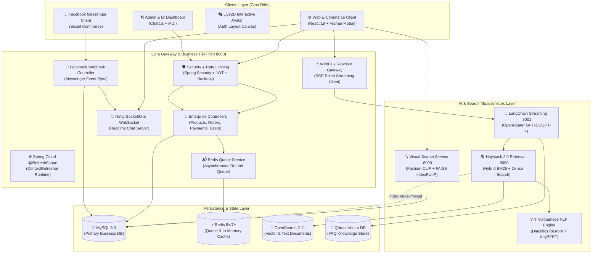

# Fashion AI: Smart E-Commerce & Omnichannel AI Platform

<p align="center">
  
</p>

<p align="center">
  <strong>Hệ sinh thái Thương mại điện tử Thời trang thông minh tích hợp Multimodal Visual Search (Fashion-CLIP), Trợ lý ảo RAG đa kênh.</strong>
</p>

<p align="center">
  <a href="https://www.oracle.com/java/"></a>
  <a href="https://spring.io/projects/spring-boot"></a>
  <a href="https://react.dev/"></a>
  <a href="https://www.python.org"></a>
  <a href="https://fastapi.tiangolo.com"></a>
  <a href="https://redis.io/"></a>
  <a href="https://www.mysql.com/"></a>
  <a href="https://opensearch.org/"></a>
  <a href="LICENSE"></a>
</p>

---

## 📑 Mục lục (Table of Contents)

- [1. Giới thiệu tổng quan](#1-giới-thiệu-tổng-quan)
- [2. Kiến trúc hệ thống (Architecture)](#2-kiến-trúc-hệ-thống-architecture)
- [3. Các trụ cột công nghệ & giải pháp (Core Pillars)](#3-các-trụ-cột-công-nghệ--giải-pháp-core-pillars)
  - [3.1. Multimodal Visual Search Engine (Fashion-CLIP + FAISS)](#31-multimodal-visual-search-engine-fashion-clip--faiss)
  - [3.2. Hybrid RAG Customer Support & Omnichannel Chatbot](#32-hybrid-rag-customer-support--omnichannel-chatbot)
  - [3.3. E-Commerce Core Engine & Fault-Tolerant Payment/Refund System](#33-e-commerce-core-engine--fault-tolerant-paymentrefund-system)
- [4. Công nghệ sử dụng (Tech Stack)](#4-công-nghệ-sử-dụng-tech-stack)
- [5. Cấu trúc dự án (Project Structure)](#5-cấu-trúc-dự-án-project-structure)
- [6. Yêu cầu môi trường (Prerequisites)](#6-yêu-cầu-môi-trường-prerequisites)
- [7. Hướng dẫn cài đặt & Khởi chạy (Getting Started)](#7-hướng-dẫn-cài-đặt--khởi-chạy-getting-started)
  - [7.1. Khởi chạy nhanh bằng Batch Scripts (Khuyến nghị)](#71-khởi-chạy-nhanh-bằng-batch-scripts-khuyến-nghị)
  - [7.2. Chạy Local Development (Backend & Frontend)](#72-chạy-local-development-backend--frontend)
  - [7.3. Khởi chạy RAG Chatbot Service (Haystack + LangChain)](#73-khởi-chạy-rag-chatbot-service-haystack--langchain)
  - [7.4. Khởi chạy Visual Search Service (Fashion-CLIP)](#74-khởi-chạy-visual-search-service-fashion-clip)
  - [7.5. Khởi chạy OpenSearch với Docker Compose](#75-khởi-chạy-opensearch-với-docker-compose)
- [8. Biến môi trường (.env & application.properties)](#8-biến-môi-trường-env--applicationproperties)
- [9. Giám sát & Đánh giá (Monitoring & Metrics)](#9-giám-sát--đánh-giá-monitoring--metrics)
- [10. Đóng gói & Kiểm tra sức khỏe dịch vụ (Build & Health Check)](#10-đóng-gói--kiểm-tra-sức-khỏe-dịch-vụ-build--health-check)
- [11. Giấy phép (License)](#11-giấy-phép-license)

---

## 1. Giới thiệu tổng quan

**Fashion AI** là một nền tảng thương mại điện tử chuyên ngành thời trang thế hệ mới, kết hợp chặt chẽ giữa **Nền tảng E-Commerce phân cấp đa biến thể** và **Trí tuệ nhân tạo (Multimodal Computer Vision & Retrieval-Augmented Generation)**.

Dự án tập trung giải quyết 3 bài toán trọng tâm trong ngành bán lẻ thời trang:
1. **Multimodal Visual Search**: Khách hàng có thể tìm thấy chính xác sản phẩm mong muốn chỉ từ 1 bức ảnh chụp ngoài đời thực thông qua mô hình thị giác học sâu `Fashion-CLIP` kết hợp chỉ mục vector `FAISS` đa tầng dưới **0.3 giây**.
2. **Context-Aware Omnichannel Support**: Trợ lý ảo RAG Hybrid Search tư vấn chuẩn xác thông số, size, chất liệu từ kho hàng theo thời gian thực (SSE Streaming), tích hợp đồng bộ đa kênh giữa Web Chat và Facebook Messenger Fanpage.
3. **High-Reliability Enterprise Engine**: Quản trị kho SKU đa biến thể (ColorCode HEX, Size, Stock), thanh toán quốc tế PayPal, cơ chế cấu hình động `@RefreshScope` không gián đoạn máy chủ, và hàng đợi hoàn tiền bất đồng bộ Redis Queue chịu lỗi cao.

---

## 2. Kiến trúc hệ thống (Architecture)

Hệ thống được thiết kế theo kiến trúc **Microservices phân tầng kết hợp Reactive Gateway**:



> 📖 **Xem tài liệu kiến trúc chi tiết và các sơ đồ tuần tự tại**: [ARCHITECTURE.md](./ARCHITECTURE.md)

---

## 3. Các trụ cột công nghệ & giải pháp (Core Pillars)

### 3.1. Multimodal Visual Search Engine (Fashion-CLIP + FAISS)
- **Vị trí**: [`qdrant_image3.py`](file:///c:/xampp/htdocs/hoanghuy/project/qdrant_image3.py), [`auto.py`](file:///c:/xampp/htdocs/hoanghuy/project/auto.py)
- **Mô hình cốt lõi**: `patrickjohncyh/fashion-clip` (Vision-Language model đã được fine-tune chuyên biệt cho miền thời trang) tạo không gian vector 512 chiều.
- **Chiến lược tính điểm Multi-Embedding**:
  $$Score = 0.2 \cdot S_{global} + 0.5 \cdot S_{clothes} + 0.3 \cdot S_{rerank}$$
  Giải thuật kết hợp đặc trưng toàn ảnh, phân vùng trang phục và xếp hạng lại, giúp giảm nhiễu tối đa từ nền ảnh và người mẫu.
- **Tốc độ chỉ mục**: Sử dụng `faiss.IndexFlatIP` duyệt vector nội tích trực tiếp trên bộ nhớ RAM, đạt tốc độ tìm kiếm tương đồng dưới **50ms**.
- **ETL tự động hóa**: Script `auto.py` tự động đọc file Excel chứa bảng màu, trích xuất hình ảnh nhúng và liên kết mã SKU sản phẩm nạp vào vector store.

### 3.2. Hybrid RAG Customer Support & Omnichannel Chatbot
- **Vị trí**: [`llm-rag/`](file:///c:/xampp/htdocs/hoanghuy/project/llm-rag), [`backend/.../FacebookWebhookController.java`](file:///c:/xampp/htdocs/hoanghuy/project/backend/src/main/java/com/web/Controllers/FacebookWebhookController.java)
- **Cơ chế Hybrid Search (Haystack 2.0 - Port 8000)**:
  - **Dense Retrieval**: Embedding ngữ nghĩa câu hỏi tìm kiếm trên OpenSearch.
  - **Sparse Retrieval**: BM25 so khớp từ khóa chính xác (mã SKU, tên danh mục, màu sắc, khoảng giá).
  - **Query Reformulation**: Tự động mở rộng và viết lại câu truy vấn của người dùng.
- **Phản hồi dòng thời gian thực (LangChain - Port 8001)**:
  - Kết nối mô hình ngôn ngữ lớn qua OpenRouter (`gpt-3.5-turbo` / `gpt-4`).
  - Truyền phát token theo thời gian thực qua giao thức Server-Sent Events (SSE) về React Frontend.
- **Bộ xử lý tiếng Việt chuyên sâu**:
  - Module `restore_diacritics`: Tự động khôi phục dấu tiếng Việt chuẩn xác khi người dùng gõ tiếng Việt không dấu.
  - Phân tích cú pháp và trích xuất từ khóa với `KeyBERT` và `VnCoreNLP`.
- **Hợp nhất đa kênh (Omnichannel)**:
  - Tích hợp trực tiếp **Facebook Messenger Webhook**, đồng bộ tin nhắn khách hàng từ Fanpage vào WebSocket server để Saler hỗ trợ hoặc AI phản hồi tự động.

### 3.3. E-Commerce Core Engine & Fault-Tolerant Payment/Refund System
- **Vị trí**: [`backend/`](file:///c:/xampp/htdocs/hoanghuy/project/backend), [`frontend/`](file:///c:/xampp/htdocs/hoanghuy/project/frontend)
- **Quản lý đa biến thể SKU**: Cấu trúc phân cấp Sản phẩm $\rightarrow$ Màu sắc (`ColorCode` trực quan mã HEX) $\rightarrow$ Kích thước $\rightarrow$ Tồn kho SKU độc lập.
- **Thanh toán quốc tế PayPal REST API**: Xử lý Capture/Authorize và COD với độ chính xác cao.
- **Hàng đợi hoàn tiền bất đồng bộ (Redis Refund Queue)**:
  - Vận hành trên các cấu trúc `refund:queue` (FIFO List) và `refund:order:index` (Hash Index tra cứu $O(1)$).
  - Tách biệt trạng thái `refund:processing`, `refund:failed`, `refund:success`.
  - Cơ chế **Auto-Retry**: Cho phép kích hoạt thử lại lệnh hoàn tiền chỉ với 1 click khi cổng thanh toán gặp trục trặc mạng.
- **Dynamic Configuration (`@RefreshScope`)**: Thay đổi cấu hình Email SMTP, PayPal Secret, OpenRouter Key từ Admin Dashboard và refresh tức thì mà **không cần restart server**.
- **Tương tác giải trí Live2D**: Tích hợp nhân vật hoạt hình Live2D Canvas tương tác theo con trỏ chuột tại màn hình đăng nhập/đăng ký.

---

## 4. Công nghệ sử dụng (Tech Stack)

| Lĩnh vực | Công nghệ / Thư viện | Mục đích sử dụng |
| :--- | :--- | :--- |
| **Backend Core** | Java 17 LTS, Spring Boot 2.7.0, Spring Data JPA | REST API nghiệp vụ, quản lý dữ liệu ORM Hibernate |
| **Reactive & Streaming** | Spring WebFlux, Server-Sent Events (SSE) | Cầu nối phản hồi dòng token thời gian thực từ LLM |
| **Security & Rate Limit** | Spring Security, JJWT, Bucket4j Core | Xác thực JWT, phân quyền RBAC, Token Bucket Rate Limiting |
| **Realtime Socket** | Netty-SocketIO 1.7.19, Spring WebSocket, STOMP | Kênh chat trực tiếp hai chiều Saler - Khách hàng |
| **Database & Caching** | MySQL 8.0, Redis 6+/7+ (Jedis 4.3) | Cơ sở dữ liệu nghiệp vụ, cache và hàng đợi hoàn tiền |
| **Frontend Platform** | React 19.1, React Router 7.5, MUI 7.3, Framer Motion | Giao diện Single Page Application, hoạt họa mượt mà |
| **State & Visualization** | Zustand 5.0, Chart.js 4.5, chartjs-plugin-zoom | Quản lý state gọn nhẹ, biểu đồ phân tích kinh doanh |
| **Visual Search (AI)** | Python 3.10+, Fashion-CLIP, FAISS, OpenCV | Trích xuất đặc trưng và tìm kiếm tương đồng vector ảnh |
| **RAG & Chatbot** | Haystack 2.0, LangChain, OpenSearch 2.11, OpenRouter | Pipeline truy xuất dữ liệu lai và streaming LLM |
| **Xử lý tiếng Việt** | KeyBERT, VnCoreNLP, Vietnamese Diacritics Restoration | Phục hồi dấu, tách từ và trích xuất thực thể tiếng Việt |
| **Containers & Scripts** | Docker, Docker Compose, Windows Batch Scripts | Đóng gói hạ tầng vector và khởi chạy dịch vụ tự động |

---

## 5. Cấu trúc dự án (Project Structure)

```text
website/
├── backend/                      # Máy chủ Spring Boot (Java 17, Port 8080)
│   ├── pom.xml                   # Cấu hình Maven (Spring Boot 2.7, WebFlux, Redis)
│   └── src/main/
│       ├── java/com/web/
│       │   ├── Config/           # Security, WebSocket, Redis, CORS, Dynamic WebConfig
│       │   ├── Controllers/      # 20 REST Controllers (Auth, Product, Order, Chat, Config)
│       │   ├── Dto/              # Data Transfer Objects
│       │   ├── Model/            # 21 JPA Entities (Product, Variant, Order, Payment, Chat)
│       │   ├── Repository/       # Spring Data JPA Repositories
│       │   ├── Service/          # Business logic: Chat, Order, Product, RefundQueue
│       │   └── GameApplication.java # Main Application Runner
│       └── resources/
│           └── application.properties # Cấu hình DB, Redis, Mail, PayPal, OpenRouter
├── frontend/                     # Giao diện người dùng React 19 SPA (Port 3000)
│   ├── .env                      # Cấu hình API Backend URL (http://localhost:8080)
│   ├── package.json              # Dependencies (React 19, MUI, Zustand, Framer Motion)
│   ├── public/                   # Tài nguyên tĩnh
│   └── src/
│       ├── assets/styles/        # CSS & SCSS styles
│       ├── components/           # Reusable components (Shop, Cart, Order, Chat)
│       │   ├── Admin/            # Quản trị: Inventory, Orders, RAG, Content, BI Stats
│       │   └── Chat/             # Cửa sổ chat tư vấn viên & Trợ lý ảo
│       ├── layouts/              # AdminLayout, SalerLayout, AuthLayout
│       ├── pages/                # Landing, Shop, Dashboard, ImageSearch, Promotions
│       ├── routes/AppRoutes.jsx  # Định tuyến toàn bộ ứng dụng
│       ├── services/             # Axios API Clients
│       └── utils/Live2D.js       # Script khởi tạo avatar hoạt hình Live2D
├── llm-rag/                      # Cụm dịch vụ Trợ lý ảo RAG
│   ├── .env.example              # Mẫu cấu hình OpenRouter, OpenSearch, URLs
│   ├── docker-compose.yml        # Docker Compose (OpenSearch, Haystack, LangChain)
│   ├── haystack-service/         # Haystack Retrieval & Ranking Service (Port 8000)
│   │   ├── app.py                # FastAPI: /retrieve, /index/mysql, /chunks, /health
│   │   └── services/rag_service.py # Pipeline Hybrid Search trên OpenSearch
│   └── langchain-service/        # LangChain Streaming Service (Port 8001)
│       └── main.py               # FastAPI: Server-Sent Events (SSE) qua OpenRouter
├── qdrant_image3.py              # Visual Search Service: Fashion-CLIP + FAISS (Port 8000)
├── chatbox1.py                   # FAQ Chatbot Service: Qdrant + KeyBERT (Port 8000)
├── auto.py                       # Script ETL bóc tách ảnh và mã SKU từ file Excel
├── febe.bat                      # Script khởi chạy đồng thời Frontend và Backend
├── llm.bat                       # Script khởi chạy cụm dịch vụ RAG
├── ARCHITECTURE.md               # Tài liệu thiết kế kiến trúc chi tiết (ADD)
├── LICENSE                       # Giấy phép mã nguồn mở MIT License
└── README.md                     # Tài liệu hướng dẫn chính của dự án
```

---

## 6. Yêu cầu môi trường (Prerequisites)

- **Java**: Phiên bản **Java 17 LTS** (Eclipse Temurin hoặc Oracle OpenJDK)
- **Maven**: Phiên bản `>= 3.8.0`
- **Node.js**: Phiên bản `>= 18.0.0` (khuyến nghị `20.x LTS`) & npm `>= 9.0.0`
- **Python**: Phiên bản `>= 3.10` (cho các dịch vụ AI, RAG và Search)
- **Cơ sở dữ liệu**: MySQL 8.0 và Redis Server 6.x trở lên đang chạy
- **Docker & Docker Compose**: Docker Engine `>= 24.0` (cho OpenSearch)
- **Hệ điều hành**: Windows 10/11 (tối ưu cho các file `.bat`) hoặc Linux/macOS

---

## 7. Hướng dẫn cài đặt & Khởi chạy (Getting Started)

### 7.1. Khởi chạy nhanh bằng Batch Scripts (Khuyến nghị)

Trên Windows, dự án đã chuẩn bị sẵn các file script tự động hóa:

#### Bước 1: Khởi chạy Giao diện Frontend & Máy chủ Backend
```cmd
febe.bat
```
*Tập lệnh sẽ mở 2 cửa sổ terminal: một bên chạy `npm start` (Frontend - `http://localhost:3000`), một bên chạy `mvn clean spring-boot:run` (Backend - `http://localhost:8080`).*

#### Bước 2: Khởi chạy Cụm Trợ lý ảo RAG
```cmd
llm.bat
```
*Kích hoạt môi trường ảo Python và khởi động đồng thời Haystack Retrieval Service (Port 8000) cùng LangChain Streaming Service (Port 8001).*

---

### 7.2. Chạy Local Development (Backend & Frontend)

Nếu bạn muốn chạy từng dịch vụ một cách thủ công:

#### A. Khởi động Backend (Spring Boot)
```bash
cd backend
mvn clean spring-boot:run
```
Máy chủ backend sẵn sàng tại `http://localhost:8080`.

#### B. Khởi động Frontend (React)
```bash
cd frontend
npm install --legacy-peer-deps
npm start
```
Ứng dụng web sẽ tự động mở tại `http://localhost:3000`.

---

### 7.3. Khởi chạy RAG Chatbot Service (Haystack + LangChain)

```bash
cd llm-rag

# 1. Khởi chạy Haystack Retrieval Service
cd haystack-service
python -m venv rag-env
rag-env\Scripts\activate      # Linux/macOS: source rag-env/bin/activate
pip install -r requirements.txt
python app.py                 # Chạy trên http://localhost:8000

# 2. Khởi chạy LangChain Streaming Service (Mở terminal mới)
cd ../langchain-service
python -m venv lc-env
lc-env\Scripts\activate       # Linux/macOS: source lc-env/bin/activate
pip install -r requirements.txt
python main.py                # Chạy trên http://localhost:8001
```

---

### 7.4. Khởi chạy Visual Search Service (Fashion-CLIP)

```bash
# Tại thư mục gốc của dự án
python -m venv search-env
search-env\Scripts\activate   # Linux/macOS: source search-env/bin/activate
pip install fastapi uvicorn transformers torch pillow faiss-cpu openpyxl jinja2
python qdrant_image3.py       # Chạy trên http://localhost:8000
```

---

### 7.5. Khởi chạy OpenSearch với Docker Compose

Để chạy cơ sở dữ liệu vector OpenSearch phục vụ lưu trữ tài liệu RAG:

```bash
cd llm-rag
docker compose up -d opensearch
```

Kiểm tra sức khỏe cluster OpenSearch:
```bash
curl -f http://localhost:9200/_cluster/health
```

---

## 8. Biến môi trường (.env & application.properties)

### A. Cấu hình Frontend (`frontend/.env`)
```properties
REACT_APP_API_URL=http://localhost:8080
```

### B. Cấu hình Backend (`backend/src/main/resources/application.properties`)
```properties
# Cơ sở dữ liệu MySQL
spring.datasource.url=jdbc:mysql://localhost:3307/test1?useSSL=false&serverTimezone=UTC&allowPublicKeyRetrieval=true
spring.datasource.username=root
spring.datasource.password=your_mysql_password
spring.jpa.hibernate.ddl-auto=update

# Bộ nhớ đệm & Hàng đợi Redis
spring.redis.host=localhost
spring.redis.port=6379
spring.redis.password=0917834505

# Cấu hình Email gửi thông báo (Gmail SMTP)
spring.mail.host=smtp.gmail.com
spring.mail.port=587
spring.mail.username=your_email@gmail.com
spring.mail.password=your_app_password

# Cổng thanh toán PayPal (Sandbox)
paypal.client-id=your_paypal_client_id
paypal.secret=your_paypal_secret_key
paypal.base-url=https://api-m.sandbox.paypal.com

# Facebook Webhook (Fanpage Messenger)
facebook.page-access-token=your_facebook_page_access_token

# Mô hình AI OpenRouter
openrouter.url=https://openrouter.ai/api/v1
openrouter.key=sk-or-v1-your-openrouter-key
openrouter.model=openai/gpt-3.5-turbo

# Bảo mật JWT
jwt.secret=9a6747f3b89c25f462a63ff638b9d3e8a1d2e3f4b5c6a7b8c9d0e1f2a3b4c5d6
```

### C. Cấu hình RAG Services (`llm-rag/.env`)
```ini
# OpenAI API Key (cho Haystack Service)
OPENAI_API_KEY=your_openai_api_key_here

# OpenRouter API Key (cho LangChain Service)
OPENROUTER_API_KEY=your_openrouter_api_key_here

# OpenSearch Configuration
OPENSEARCH_HOST=localhost:9200
OPENSEARCH_INDEX=documents

# Service URLs
HAYSTACK_SERVICE_URL=http://localhost:8000
LANGCHAIN_SERVICE_URL=http://localhost:8001
```

---

## 9. Giám sát & Đánh giá (Monitoring & Metrics)

Hệ thống cung cấp các chỉ số đo lường hiệu năng và độ tin cậy thời gian thực:

| Hạng mục | Chỉ số đo lường (Metrics) | Cơ chế thu thập & Giám sát |
| :--- | :--- | :--- |
| **Visual Search (AI)** | • Thời gian trích xuất vector ảnh (ms)<br>• FAISS Search Latency (ms)<br>• Top-10 Retrieval Precision | Ghi log thời gian thực qua FastAPI Middleware & Console metrics |
| **RAG Chatbot** | • First Token Latency (TTFT)<br>• Total Response Duration (s)<br>• OpenRouter token consumption | LangChain Callback Handler & Logback Spring WebFlux |
| **Hàng đợi hoàn tiền** | • Số lượng yêu cầu chờ (`refund:queue`)<br>• Giao dịch lỗi cần retry (`refund:failed`)<br>• Tỷ lệ xử lý thành công (%) | Redis Hash Counters & Dashboard `/admin/refunds` |
| **Hệ thống lõi** | • Tần suất gọi API theo IP (Rate Limit hits)<br>• Trạng thái kết nối WebSocket Live Chat<br>• Thời gian thực thi truy vấn JPA MySQL | Bucket4j Filters & Spring Boot Actuator `/actuator/health` |

---

## 10. Đóng gói & Kiểm tra sức khỏe dịch vụ (Build & Health Check)

### 10.1. Đóng gói sản xuất (Production Build)

```bash
# 1. Đóng gói ứng dụng Backend (tạo file .jar)
cd backend
mvn clean package -DskipTests

# 2. Đóng gói giao diện Frontend (tạo thư mục build/)
cd ../frontend
npm run build
```

### 10.2. Kiểm tra sức khỏe các dịch vụ (Service Health Checks)

Sau khi khởi chạy các dịch vụ, kiểm tra trạng thái hoạt động thông qua các endpoint:

| Dịch vụ | Cổng | Endpoint Kiểm Tra | Phản Hồi Kỳ Vọng |
| :--- | :--- | :--- | :--- |
| **Backend Actuator** | `8080` | `http://localhost:8080/actuator/health` | `{"status":"UP"}` |
| **Haystack RAG** | `8000` | `http://localhost:8000/health` | `{"status":"healthy","service":"haystack-rag"}` |
| **OpenSearch Cluster** | `9200` | `http://localhost:9200/_cluster/health` | `{"cluster_name":"...","status":"green/yellow"}` |
| **Visual Search Web** | `8000` | `http://localhost:8000/` | Trả về trang giao diện tìm kiếm hình ảnh HTML |
| **LangChain Service** | `8001` | `http://localhost:8001/docs` | Trang tài liệu OpenAPI Swagger |

---

## 11. Giấy phép (License)

Dự án được phân phối dưới giấy phép **MIT License**. Xem thêm chi tiết tại file [LICENSE](./LICENSE).

<p align="center">
  <sub>Đồ án Nghiên cứu & Phát triển Nền tảng Thương mại Điện tử Thời trang Thông minh Fashion AI.</sub>
</p>